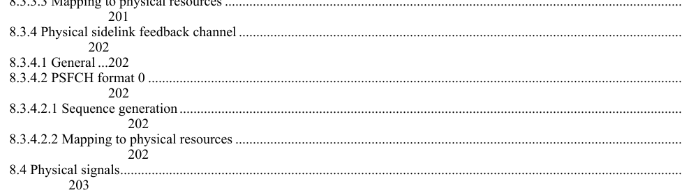
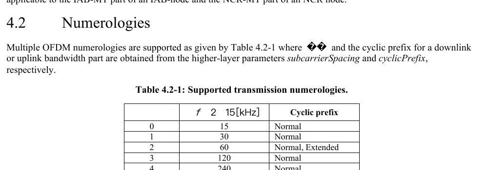
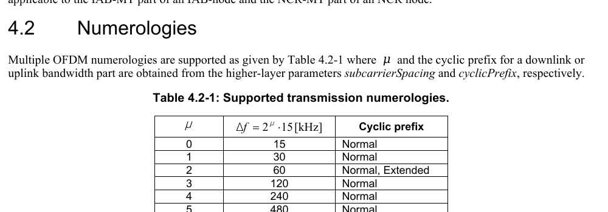
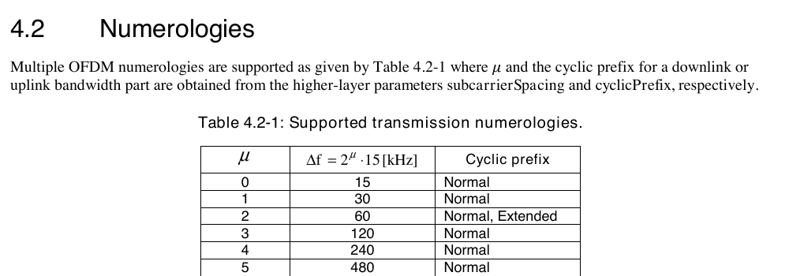

# 3GPP Spec PDFs

Get any 3GPP spec as a clean, searchable PDF with a working table of contents and bookmarks, without converting Word files yourself.

**[Read the illustrated guide →](https://claude.ai/artifact/Xs4QKGTixuvAB1W6fM12d2)** (diagrams of the ETSI numbering and the fetch flow, and the converter comparison side by side)

## The trick: ETSI already publishes the PDF

3GPP posts its specs as zipped Word files. ETSI, one of the 3GPP partners, republishes every spec as an official PDF made from that same Word file, under a number you can work out. Put a `1` in front:

| 3GPP | ETSI | Folder on etsi.org |
|---|---|---|
| TS 38.211 | ETSI TS **1**38 211 | `etsi.org/deliver/etsi_ts/138200_138299/138211/19.05.00_60/ts_138211v190500p.pdf` |

Reports (TR, numbers x.8xx and x.9xx) live under `etsi_tr/` instead.

Same text, same version, typeset from Word by ETSI. Equations, tables, the printed contents and the bookmarks all come out right. The catch: ETSI usually publishes a week or a few weeks after 3GPP, and a few study reports never get an ETSI copy.

**Version codes in file names.** 3GPP file names carry the version as three characters (major, technical, editorial). Numbers from 10 up are letters, so `a` = 10 … `j` = 19. `38211-j50` is version 19.5.0.

## What `get_spec.py` does

For each spec number, it compares the newest version on ETSI with the newest on 3GPP:

- **ETSI is current** → downloads the ETSI PDF, names it from its cover page and files it. No manual step. Most specs go this way.
- **ETSI is behind or has no copy** → downloads the 3GPP Word file into a `Word/` subfolder. You open it in Word (Windows) or the WPS Office app (Mac), save as PDF, and run `fix_bookmarks.py` if WPS made the PDF.

## Why not just convert the Word file?

The same TS 38.211 19.5.0 through four routes, all tried on macOS. 3GPP Word files hold old-style equation objects and a field-based contents list, and most converters trip on one or the other.

| Route | Result | |
|---|---|---|
| Apple Pages, export to PDF | Broken contents: every contents line wraps, header and footer sit on the paper edge |  |
| WPS Office command line | Broken maths: symbols drop out |  |
| WPS Office app, save as PDF | Good, but bookmark titles lose the space after the number ("4.2Numerologies"); `fix_bookmarks.py` repairs it |  |
| ETSI official PDF | Best: nothing to fix, nothing to open by hand |  |

**Mac or Windows?** The ETSI route is just a download, so it works on any system. The converter results above are from macOS only. On Windows, Microsoft Word is the natural fallback: in Save as PDF → Options, tick "Create bookmarks using: Headings". The Windows steps are untested.

## Run it

Needs Python 3 and `pdftotext` from poppler. The bookmark scripts also need `pypdf`.

```sh
brew install poppler            # Debian/Ubuntu: sudo apt install poppler-utils
python3 -m pip install pypdf    # Windows: scoop/choco install poppler, then use py instead of python3
```

Fetch specs (as many as you like):

```sh
python3 get_spec.py 38.211 38.331 23.501 --dest "~/3GPP Specifications"
```

```
38.211: ETSI PDF 19.5.0 -> Release 19 - Sep'26/38211-j50_Physical channels and modulation.pdf
38.331: ETSI PDF 19.4.0 -> Release 19 - Sep'26/38331-j40_Radio Resource Control (RRC); Protocol specification.pdf
23.501: ETSI PDF 19.9.0 -> Release 19 - Sep'26/23501-j90_System architecture for the 5G System (5GS).pdf
```

Options:

| Option | What it does |
|---|---|
| `--dry-run` | Show what it would fetch without saving anything |
| `--dest DIR` | Library folder. Default: `$SPEC_LIB`, else `~/3GPP Specifications` |
| `--release 18` | Take versions from another release (default 19) |
| `--folder NAME` | Override the snapshot subfolder name |

When the script says "Word file":

```
38.843: not on ETSI; 3GPP i00 Word file -> Release 18 - Sep'26/Word/38843-i00_Study on Artificial Intelligence (AI)-Machine Learning (ML) for NR air interface.docx
```

open it, save as PDF, then:

```sh
python3 fix_bookmarks.py saved.pdf fixed.pdf
```

### Where files go

| Part | Example | Rule |
|---|---|---|
| Folder | `Release 19 - Sep'26/` | One folder per release and quarterly 3GPP drop, so older sets stay intact |
| File | `38211-j50_Physical channels and modulation.pdf` | Number, version code, then the title from the cover page |
| Word files | `Word/38843-i00_….docx` | Only when ETSI is behind or missing |

## Keep the set current

3GPP updates specs four times a year (March, June, September, December). A few weeks after each, rerun the script on your whole list; it makes a new folder such as `Release 19 - Dec'26` and leaves the previous set alone. Until ETSI catches up, it falls back to Word files.

```sh
python3 get_spec.py $(cat my-specs.txt)
```

## A PDF with no bookmarks at all

Some documents from outside 3GPP, such as GSMA's NG.114 IMS voice profile, come as PDFs without bookmarks. If the printed page numbers match the PDF's pages ("Page N of M"), `add_bookmarks.py` builds them from the printed contents:

```sh
python3 add_bookmarks.py NG.114.pdf NG.114-bookmarked.pdf
```

```
contents pages: 2-4
bookmarks added: 123
```

It finds the contents pages by itself. If it picks the wrong range, pass the last contents page as a third argument.

## Tests

```sh
python3 -m unittest discover -s tests
```

## Notes

- The scripts only read public pages on etsi.org and 3gpp.org, pausing briefly between requests. Please keep it that way.
- This repo contains no specifications. Screenshots are short excerpts from TS 38.211 V19.5.0 (2026-09) for comparison. 3GPP specifications are © 3GPP Organizational Partners; ETSI PDFs are © ETSI and free to download from etsi.org.

## License

MIT (the scripts). See [LICENSE](LICENSE).
